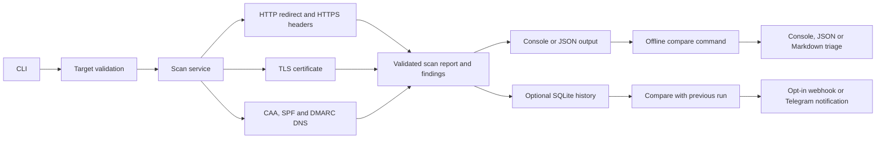

# LotusWatch: a defensive website configuration case study

LotusWatch is a Python command-line project for observing the security
configuration of a **public website** over time. It turns a small set of HTTP,
TLS, and DNS observations into findings that an analyst can review and compare.
It does not exploit a target, inspect application traffic, collect endpoint
telemetry, or claim to be a SIEM, IDS/IPS, or complete penetration test.

## Problem and intended use

Transport and browser controls can regress between deployments: an HTTP route
may stop redirecting to HTTPS, a certificate may approach expiry, or a selected
security header may disappear. A single scan records what LotusWatch observed;
comparison highlights which findings were added, changed, resolved, or
unchanged. This helps an operator decide what to verify with the system owner.
A finding is a configuration observation, not proof of exploitation or
compromise.

## Architecture and data flow



`src/lotuswatch/scanner.py` runs five check groups in order: HTTP-to-HTTPS
redirect, TLS certificate, HTTPS security headers, CAA, then SPF/DMARC. Each
check returns a structured result. Completed observations are converted into
findings; controlled operational errors remain check results instead of being
reported as missing security controls. The `ScanCheckRunner` interface lets
tests supply fake check results without network requests.

`lotuswatch compare` has a separate, offline path: it loads two bounded,
validated JSON scan reports for the same canonical target, computes finding
identities and differences, then renders console, JSON, or Markdown output.
It makes no website or DNS request. `monitor run` uses the same scan service,
stores a validated report in local SQLite, and compares it with the newest
earlier compatible run. Notifications are disabled unless selected explicitly.

## Components and security decisions

| Component | Current behavior | Boundary or limitation |
| --- | --- | --- |
| HTTP/HTTPS | Streamed GET requests check HTTP-to-HTTPS redirects and one HTTPS response's selected headers; response bodies are not retained. | Redirects are bounded and stay on the original hostname. A successful redirect does not prove the application is safe or available. |
| TLS | A verified handshake observes certificate identity, issuer, validity, version, and cipher. | The hostname remains the SNI and certificate identity even when the socket connects to a pinned IP. No full protocol/cipher or revocation grading. |
| Security headers | Checks HSTS, CSP presence, X-Content-Type-Options, Referrer-Policy, Permissions-Policy, and framing controls. | Obvious empty/malformed `frame-ancestors` and X-Frame-Options values do not count as protection. This is not a full CSP evaluator. |
| DNS security | Bounded CAA and TXT queries observe issuance policy, SPF, and DMARC. | No DNSSEC validation, DKIM discovery, full SPF evaluation, or real email testing. |
| SQLite monitoring | Named targets, validated scan history, compatible-baseline comparison, explicit retention, integrity check, and non-overwriting backup. | Local data is not encrypted or synchronized; an external scheduler is needed for recurring runs. |
| Change detection | A versioned fingerprint identifies a finding ID on a normalized target; snapshots become `added`, `changed`, `resolved`, or `unchanged`. | Severity and evidence can change without changing identity. The fingerprint is neither anonymization nor a signature. |
| Notifications | Opt-in severity filtering selects added and changed current findings for HTTPS webhook or Telegram delivery; dry run previews selection. | Best effort after storage; no persistent queue, replay, or exactly-once guarantee. |

The network boundary was designed to avoid sending website checks to loopback,
private, link-local, or other non-global IP addresses. Literal IP targets are
rejected unless `ipaddress` classifies them as global. For a hostname, every
returned A/AAAA address must be global; a mixed answer set fails closed. The
HTTP transport pins each request to a checked address while retaining the
original Host header and TLS SNI, and the TLS check connects its socket to a
checked address. This closes the application-level gap where a hostname could
resolve to a private address between a preliminary check and connection.
Environment proxy inheritance is disabled for these HTTP checks. Redirects
are validated before another request and cannot expand the scan to another
hostname. The header check also rejects an out-of-scope endpoint from the
redirect result.

These safeguards depend on Python's address classification and the local DNS
resolver. DNS lookup and connect each have bounded time, but their combined
time can exceed one connect timeout. Application code cannot control OS
routing, transparent proxies, or a compromised host; an egress firewall is
appropriate when stronger network isolation is required. A legitimate redirect
to another hostname is reported as out of scope until an explicit authorization
model exists.

## Findings and triage

Each finding has an ID, severity, title, explanation, bounded evidence,
recommendation, and optional reference. The severity order is `critical`,
`high`, `medium`, `low`, then `info`. For example, an expired certificate is
critical; a certificate hostname mismatch is high; a missing CSP or unsafe
HTTP-to-HTTPS redirect is medium; a short HSTS duration is low; and absence of
an effective CAA policy is informational. These labels guide review rather
than quantify business impact. A check error is not a positive security finding.

For a comparison, review added and changed current findings in severity order.
Verify resolved findings against expected configuration; unchanged means only
that the serialized finding did not change. The optional `--fail-on` policy
sets an automation exit threshold for added and changed current findings, not
an overall risk score.

## Reproduce the portfolio demo without a scan

From the repository root in Windows PowerShell, with Python 3.12 or newer, use
the current `main` checkout. The published `0.1.0b1` package predates the
Markdown triage and network-hardening changes. No new release is implied by
this case study.

```powershell
py -3.14 -m venv .venv
.\.venv\Scripts\python.exe -m pip install -e ".[dev]"
.\.venv\Scripts\lotuswatch.exe compare examples/baseline-report.json examples/current-report.json --format markdown --output triage.md
Get-Content .\triage.md
```

Use an installed Python version in place of `3.14` if needed. After activating
the virtual environment, the third line can be run exactly as:

```powershell
lotuswatch compare examples/baseline-report.json examples/current-report.json --format markdown --output triage.md
```

The command prints:

```text
Comparison report written: triage.md
Review this file before sharing; it may contain sensitive report data.
```

The input files are synthetic reports for the reserved `demo.example` name.
The output has one `added` CAA finding, one `changed` medium CSP finding, one
`resolved` DMARC finding, and one `unchanged` Permissions Policy finding. The
review table places medium CSP before informational CAA. The generated file
matches [`examples/triage-report.md`](../examples/triage-report.md) apart from
the `Compared at` UTC timestamp, which is generated each run; the baseline and
current scan timestamps come from the fixed input files. LotusWatch refuses to
overwrite `triage.md`, so review, rename, or remove it before repeating the
command. The sample Markdown omits raw evidence; inspect the JSON inputs when
explaining why a finding changed.

To check the checkout after installing `.[dev]`:

```powershell
.\.venv\Scripts\ruff.exe format --check .
.\.venv\Scripts\ruff.exe check .
.\.venv\Scripts\python.exe -m pytest -q
```

The test suite uses synthetic inputs and mocked network responses. GitHub CI
also runs the supported Python 3.12, 3.13, and 3.14 matrix and installed
distribution checks; see the status badge in the README for the current run.

## Portfolio sharing review

The tracked tree contains no `.env`, database, journal, log, or private-key
file. The current `.gitignore` covers common local secrets, reports, and SQLite
artifacts, but ignored files can still be forced into a commit. A pattern check
of tracked text and reachable local commit diffs found no PEM private key or
AWS, GitHub, Slack, or Telegram token-shaped value. This is a bounded pattern
review, not proof that every possible secret is absent. Credential-bearing
URLs found by the pattern check are deliberate rejection fixtures in tests;
they are not usable account credentials. The JSON examples and compatibility
fixtures use reserved example names and synthetic identifiers; the apparent
DMARC address in the sample report is under `demo.example`.

One concrete privacy consideration remains: reachable Git commit metadata
includes a personal `gmail.com` author address. Publishing full Git history
exposes commit metadata even when current files contain no personal data.
Review whether that is acceptable before any visibility decision; a separate
public overview is an option if it is not. This review did not change repository
visibility, rewrite history, or inspect refs unavailable in the local clone.
Real scan reports, monitoring databases, notification events, scheduler logs,
and target URLs may reveal configuration details and require separate review
before sharing. Notification credentials are read from environment variables
when delivery is requested; the repository contains variable names and test
placeholders, not the operator's secret values.

## Interview summary and CV wording

In a short walkthrough: show the two JSON inputs, run the offline compare
command, explain why the medium CSP change appears above the informational
CAA addition, and describe how public-address pinning prevents a DNS rebinding
window during the website checks. Then explain what a finding cannot prove.

Possible CV bullets, subject to the candidate's actual contribution:

- Built a Python CLI that records bounded HTTP, TLS, security-header, CAA, SPF,
  and DMARC observations and tracks finding changes in local SQLite history.
- Added public-IP validation, connection pinning, same-hostname redirect scope,
  and mocked regression tests to reduce unintended network access.
- Produced an offline, reproducible Markdown triage demo from synthetic reports
  and documented the limits of severity, provenance, and notification delivery.

For the detailed behavior and authorized-use boundary, see
[`scope.md`](scope.md), [`triage.md`](triage.md), and [`SECURITY.md`](../SECURITY.md).
